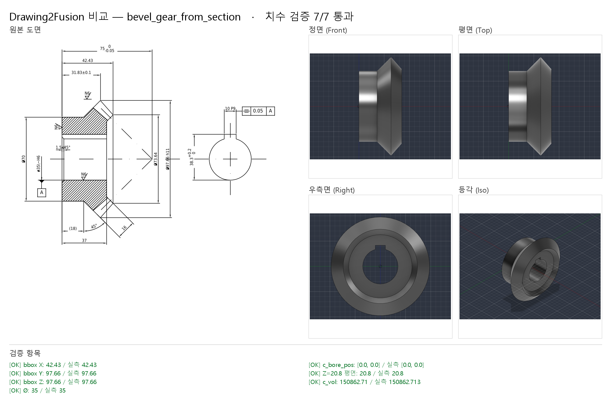

# 공개 도면 테스트 — QCAD 예제 DXF 3장

> 2026-10-24 · Fusion 2704.1.53 · 도면: `samples/drawings/public/` (출처·라이선스: [SOURCES.md](../samples/drawings/public/SOURCES.md))

직접 만든 테스트 도면(`tools/make_sample_dxf.py`)이 아닌, 다른 사람이 그린 실제 CAD 도면으로 DXF 리더를 시험했다.
QCAD 저장소의 `examples/` 도면 3장(GPL-3.0)을 썼다.

## 1. 결과 요약

| 도면 | 내용 | DXF 자동 경로 | 채팅 판독 경로 |
|---|---|---|---|
| `qcad_projection.dxf` | 클레비스(포크) 3면도(제1각) + 등각도, 치수 없음 | ✅ 빌드됨 — 축 Ø6 + 칼라 Ø10 + 포크 블록 9.54×8 근사, 경고로 한계 표시 | — |
| `qcad_flange.dxf` | 마름모 플랜지 평면도 + 해칭 단면도 + 등각 절단도 | ⛔ 멈추고 질문 (E208 단면도, E204 뷰 폭 불일치) | (미실시) |
| `qcad_example01.dxf` | 베벨기어 단면도 + 키홈 측면도, 공차·기하공차 | ⛔ E102 (단면도뿐이라 정면/평면/측면 짝이 없음) | ✅ **7/7**, 부피 실측 = 계산값 |

자동 경로가 **틀린 모델을 조용히 만들지 않고 멈춘다**는 것이 이번 테스트에서 확인하려던 핵심이고, 3장 모두 그렇게 동작했다.
멈춘 도면은 채팅 판독([image-reading.md](image-reading.md))으로 넘긴다.

## 2. DXF 리더에서 고친 것

| 증상 | 원인 | 조치 |
|---|---|---|
| 보조선이 형상으로 들어감 | `aux` 레이어 (QCAD 작도선) | 작도 레이어 이름 패턴(`aux`, `construction*`, `defpoints`, `보조*` …)과 XLINE/RAY 제외 |
| 1점쇄선(DASHDOT)이 숨은선으로 잡힘 | 선 종류 판별 순서 | 중심선 판별을 숨은선보다 먼저 |
| 등각도가 뷰로 잡혀 정렬이 깨짐 | 입체도 판별 없음 | 30°/150°/수직 세 방향 선이 모두 있으면 등각도로 보고 제외 (INFO) |
| **마름모 플랜지 평면도가 등각도로 오판** → 뷰 0개 | 마름모 변이 31°라 30° ±3° 범위에 들어감 | 허용 ±1°, 세 방향(30°·150°·수직)이 다 있어야 하고 등각선 6개 이상 |
| 단면도 해칭을 외형으로 해석 | 해칭 무시 | HATCH가 있으면 E208 BLOCK 질문 "단면도를 무시하고 외형 투상도만으로 모델링할까요?" |
| 뷰가 비면 예외로 종료 | 빈 목록 처리 | E102 메시지에 이유 목록을 붙여 안내 |
| 곡선 외곽(포크)이 곧은 벽으로 바뀌는데 말이 없음 | — | 높이 구간 폭을 전체 실루엣(선+호)에서 재고, 곡선/경사면 WARN |
| 치수 없는 도면에서 "추론값 사용" 알림이 10번 | 파라미터마다 경고 | 4개 이상이면 한 번에: "치수 표기가 없어 형상에서 잰 값 8개를 썼습니다: L, H, …" |

## 3. 베벨기어 — 채팅 판독 기록

원본 DXF를 이미지로 그린 뒤(`samples/drawings/images/bevel_gear_qcad_example01.png`) 채팅에서 읽었다.

**읽은 치수:** Ø35 H6 (구멍), 1.5×45° (구멍 모따기), Ø70 (허브), Ø97.66 h11 (이끝 바깥), Ø73.64 (이끝 안쪽),
31.83±0.1 / 42.43 / 37 (왼쪽 면에서 축 방향 거리), 10 P9 / 38.3 +0.2/0 (키홈), 75 0/−0.05 (피치 원뿔 꼭짓점), 16 (이폭), 45° (피치각)

**검산:**
- 참고치수 (18) = 31.83 − (97.66 − 70)/2 = **18.00** ✔ → 뒤 원뿔이 45°라는 해석 확인
- 이폭 16 = 이끝 (31.83, 48.83) → (42.43, 36.82) 길이 = **16.02** ✔
- 픽셀 비율: 75 → 216 px, 31.83 → 91.7 px, 37 → 106.6 px (모두 2.88 px/mm) ✔

**모델:** 반단면 8점 프로파일 회전 + 키홈 관통 컷 (`samples/specs/bevel_gear_from_section.json`).
치형은 도면에 없어서(모듈·잇수 없음) 블랭크까지만.

**검증 7/7:**

| 검사 | 기대 | 실측 |
|---|---|---|
| bbox X / Y / Z | 42.43 / 97.66 / 97.66 | 같음 |
| 구멍 Ø | 35 | 35 |
| 구멍 위치 (X축) | (0, 0) | (0, 0) |
| 키홈 바닥 평면 Z | 20.8 | 20.8 |
| 부피 | 150,862.71 mm³ (Pappus 152,161.52 − 키홈 1,298.81) | 150,862.71 |

### 판독 실수와 그 결과로 생긴 검사
첫 빌드에서 키홈을 YZ 스케치 좌표를 잘못 써서 **−Y 쪽**에 만들었다. bbox·구멍·부피는 모두 통과(6/6)했고,
비교 이미지의 우측면에서 키홈이 옆에 있는 것을 보고서야 알았다.
→ `plane` 검사 추가 (측정: 몸체의 축 정렬 평면 목록, 비교: 그 좌표에 평면이 있는지, 실패 코드 E408).
잘못된 모델을 그대로 두고 `d2f verify`를 다시 돌리면 `🔴 [E408] 평면 위치 불일치`로 멈추는 것을 확인했고,
고친 스펙으로 다시 빌드해 7/7.

## 4. 남은 것

- 단면도 읽기(해칭 영역 = 재료, 회전체면 반단면 → revolve)를 DXF 리더에 넣으면 example01은 자동으로도 가능
- `qcad_flange`는 평면도 + 단면도 2면 구성이라, 단면도를 측면도 대신 쓰는 규칙이 필요
- 포크(`qcad_projection`)의 홈·평면·가로 구멍은 정면·측면도의 원과 곡선 외곽 해석이 필요 (DXF 리더 4장 "아직 못 읽는 것")
