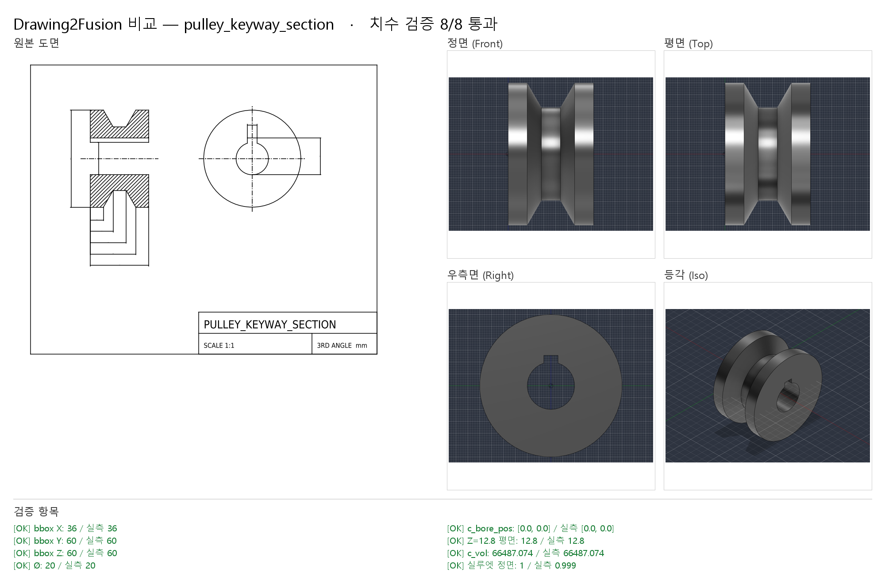

# 회전체 단면도 읽기 + 독립 검증 + 회귀 테스트

> 2026-10-24 · Fusion 2704.1.53 · 회귀 결과 원본: `out/regression.md` (`py -3 tools\regress.py`로 다시 만들 수 있음)

## 1. 이번에 한 것

| 항목 | 내용 |
|---|---|
| 회전체 단면도 자동 읽기 | 해칭이 있는 반단면 → 회전 프로파일 (`d2f/extract/section_reader.py`). 해칭 안 된 기어 이 포함, 키홈 자동 인식, 연쇄 치수·모따기·경사각 식 |
| 독립 실루엣 검사 (E406) | 모델 메시를 뷰 방향으로 투영한 모양 vs **도면 선이 둘러싼 영역**. 스펙에서 나온 값이 아니라서 스펙 자체가 틀린 것도 잡음 |
| 작은 작도 오차 규칙 | 치수 문자와 그려진 길이 차이가 max(0.05 mm, 0.3%) 이내면 치수 문자 사용 (실제 도면 Ø73.64가 73.677로 그려져 있던 것) |
| 테스트 도면 5장 추가 | 플랜지 부시(연쇄 치수·모따기), V홈 풀리(60° 홈·키홈), 기어 블랭크(해칭 안 된 이), 깨진 도면 2장 |
| 회귀 테스트 | `tools/regress.py`: 샘플 30개 + **돌연변이 6개**를 실제 Fusion에서 실행하고 기대 동작과 비교 |

## 2. 결과: 36/36 기대대로

| 케이스 | 결과 | 종료 코드 | 검증 | 실루엣 IoU | 알림 코드 | 비고 |
|---|---|---|---|---|---|---|
| spec/bevel_gear_from_section | ✅ | 0 (기대 0) | 7/7 | - | - |  |
| spec/block_basic | ✅ | 0 (기대 0) | 4/4 | - | - |  |
| spec/block_features | ✅ | 0 (기대 0) | 9/9 | - | - |  |
| spec/bracket_l | ✅ | 0 (기대 0) | 8/8 | - | E207 |  |
| spec/clamp_bracket_from_image | ✅ | 0 (기대 0) | 13/13 | - | E207 |  |
| spec/flange | ✅ | 0 (기대 0) | 12/12 | - | - |  |
| spec/plate_holes | ✅ | 0 (기대 0) | 10/10 | - | - |  |
| spec/shaft_stepped | ✅ | 0 (기대 0) | 4/4 | - | - |  |
| broken/dim_mismatch | ✅ | 1 (기대 1) | 2/5 | - | E401 E402 E403 ERROR |  |
| broken/fillet_too_big | ✅ | 1 (기대 1) | - | - | E205 ERROR |  |
| broken/hole_outside | ✅ | 1 (기대 1) | - | - | E205 ERROR |  |
| broken/needs_answer | ✅ | 2 (기대 2) | - | - | E105 E202 E207 |  |
| dxf/block_basic | ✅ | 0 (기대 0) | 7/7 | front 1.000, side 1.000, top 1.000 | - |  |
| dxf/bracket_l | ✅ | 0 (기대 0) | 11/11 | front 1.000, side 1.000, top 1.000 | - |  |
| dxf/broken_dim_override | ✅ | 2 (기대 2) | - | - | E107 |  |
| dxf/broken_dim_override +답변 | ✅ | 0 (기대 0) | 7/7 | front 1.000, side 1.000, top 1.000 | E107 | E107 질문에 '그려진 값' 선택 |
| dxf/broken_keyway_noview | ✅ | 2 (기대 2) | - | - | E202 E207 E208 |  |
| dxf/broken_keyway_noview +답변 | ✅ | 0 (기대 0) | 8/8 | front 0.999 | E202 E207 E208 | 키홈 폭 질문에 6 입력 |
| dxf/broken_section_dim | ✅ | 2 (기대 2) | - | - | E107 E207 E208 |  |
| dxf/broken_section_dim +답변 | ✅ | 0 (기대 0) | 7/7 | front 0.999 | E107 E207 E208 | E107 질문에 '그려진 값' 선택 |
| dxf/bushing_section | ✅ | 0 (기대 0) | 7/7 | front 0.999 | E207 E208 |  |
| dxf/flange | ✅ | 0 (기대 0) | 15/15 | front 0.998, top 0.992 | - |  |
| dxf/gear_blank_section | ✅ | 0 (기대 0) | 7/7 | front 1.000 | E207 E208 |  |
| dxf/plate_holes | ✅ | 0 (기대 0) | 12/12 | front 1.000, side 1.000, top 0.999 | - |  |
| dxf/plate_one_view | ✅ | 0 (기대 0) | 8/8 | top 1.000 | E207 |  |
| dxf/pulley_keyway_section | ✅ | 0 (기대 0) | 8/8 | front 0.999 | E207 E208 |  |
| dxf/stepped_block | ✅ | 0 (기대 0) | 7/7 | front 0.994, side 1.000, top 1.000 | - |  |
| public/qcad_example01 | ✅ | 0 (기대 0) | 8/8 | front 0.998 | E107 E207 E208 | 베벨기어 단면도 → 자동 회전체 |
| public/qcad_flange | ✅ | 2 (기대 2) | - | - | E204 E205 E207 E208 | 평면도 + 단면도(회전체 아님) → 질문으로 멈춤 |
| public/qcad_projection | ✅ | 1 (기대 1) | 5/7 | front 0.769, side 0.985, top 0.917 | E207 E406 ERROR | 곡선 포크를 상자로 근사한 모델 → 실루엣 검사가 잡아내야 정상 (예전엔 통과로 잘못 보고) |
| mutation/block_basic: 길이 L 80→90 (치수 오독) | ✅ | 1 (기대 None) | 4/7 | front 0.891, side 1.000, top 0.891 | E405 E406 ERROR | E406 가 잡아야 함 |
| mutation/stepped_block: 윗단 길이 bx2 30→40 | ✅ | 1 (기대 None) | 5/7 | front 0.901, side 1.000, top 1.000 | E405 E406 ERROR | E406 가 잡아야 함 |
| mutation/plate_holes: 구멍 하나 위치 X 10→13 | ✅ | 1 (기대 None) | 11/12 | front 1.000, side 1.000, top 0.999 | E404 ERROR | E404 가 잡아야 함 |
| mutation/bushing_section: 몸통 길이 L4 40→45 | ✅ | 1 (기대 None) | 5/7 | front 0.917 | E405 E406 ERROR | E406 가 잡아야 함 |
| mutation/gear_blank_section: 바깥 지름 D4 100→110 | ✅ | 1 (기대 None) | 5/7 | front 0.899 | E405 E406 ERROR | E406 가 잡아야 함 |
| mutation/pulley_keyway_section: 키홈을 반대쪽(−Z)에 가공 | ✅ | 1 (기대 None) | 7/8 | front 0.999 | E408 ERROR | E408 가 잡아야 함 |

### 읽는 법
- **spec/** 손으로 쓴 스펙 8개 — 전부 통과
- **broken/**, **dxf/broken_*** 일부러 틀린 입력 — 기대한 코드로 멈추거나 실패. `+답변`은 같은 도면에 질문 답을 넣어 끝까지 통과하는지
- **dxf/** 생성 도면 12장 — 치수 검증 전부 통과, 실루엣 IoU 0.992~1.000
- **public/** 공개 도면 — 베벨기어는 자동 회전체로 8/8. 플랜지는 회전체가 아니라 질문으로 멈춤
- **public/qcad_projection** — 이전 테스트에서는 "완료(통과)"로 보고됐는데, 실제로는 곡선 포크를 상자로 근사한 **틀린 모델**이었음. 새 실루엣 검사가 정면 IoU 0.769로 ERROR를 냄. 이제 기대 결과가 "실패해야 정상"
- **mutation/** 리더가 만든 스펙에 실수 하나를 심어 다시 빌드 → 검증이 잡아야 통과

## 3. 돌연변이 테스트가 보여 준 것

| 심은 실수 | 스펙 자체 검사 (bbox) | 잡은 검사 |
|---|---|---|
| 길이 L 80→90 | 통과 (기대값도 L을 따라 90으로 바뀜) | **실루엣 E406** (IoU 0.891), 부피 E405 |
| 윗단 길이 30→40 | 통과 | **실루엣 E406** (0.901), 부피 |
| 구멍 위치 X 10→13 | — | 구멍 위치 E404 |
| 부시 몸통 길이 40→45 | 통과 | **실루엣 E406** (0.917), 부피 |
| 기어 바깥 지름 100→110 | 통과 | **실루엣 E406** (0.899), 부피 |
| 키홈을 반대쪽에 가공 | 통과, 부피도 같음, 실루엣도 같음 (0.999) | **평면 위치 E408** |

**스펙에서 기대값을 만드는 검사는 스펙이 틀리면 같이 틀립니다.** 치수를 잘못 읽어 파라미터가 틀어지면 bbox 검사는 그대로 통과합니다.
도면 선에서 직접 만든 실루엣과 면 위치 검사가 그 빈틈을 메웁니다. 부피 기대값은 리더가 숫자로 계산해 두기 때문에 이런 경우에도 경고(E405)가 납니다.

## 4. 회전체 단면도 예 — V홈 풀리 (8/8, 실루엣 0.999)

- 홈 바닥 지름은 치수가 없음 → 60° 경사면을 따라 `D3/2 - (L4 - L3) * tan60`으로 계산 (INFO)
- 단면 위쪽 반의 안쪽 선이 12.8 → 키홈. 끝 모양의 홈에서 폭 6, 치수 22.8(구멍 바닥~키홈 바닥)에서 깊이
- 키홈 띠(구멍 선과 키홈 선 사이)는 축 쪽 빈 영역이라 재료에 넣지 않음

## 5. 베벨기어: 자동 읽기 = 손 판독

같은 도면(QCAD example01)을 채팅으로 손 판독한 스펙과 자동 리더 결과를 비교하는 단위 테스트를 넣었습니다.
꼭짓점 8개가 0.03 mm 안에서 같고, 부피 기대값 차이 0.01% 미만. 두 가지 독립 경로가 같은 답을 냅니다.

## 6. 한계

- 회전체가 아닌 단면도(판의 부분 단면, 리브), 멈춤 키홈·가로 구멍은 아직 못 읽음
- 실루엣 검사는 벡터 도면(DXF)에서만. 사진 판독 경로는 비교 이미지(`compare.png`)를 눈으로 확인
- 실루엣은 바깥 모양만 봄 — 안쪽 포켓·구멍은 구멍 검사, 부피, 평면 검사 몫
