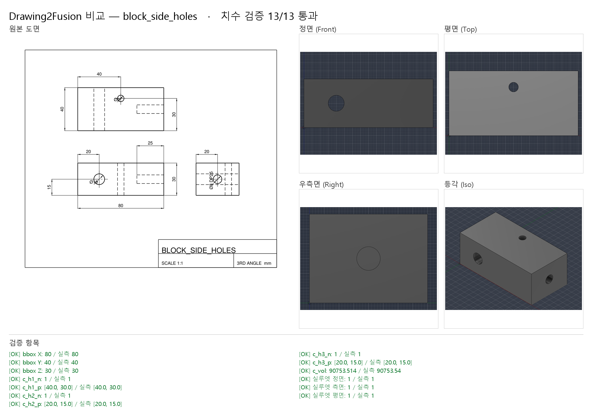
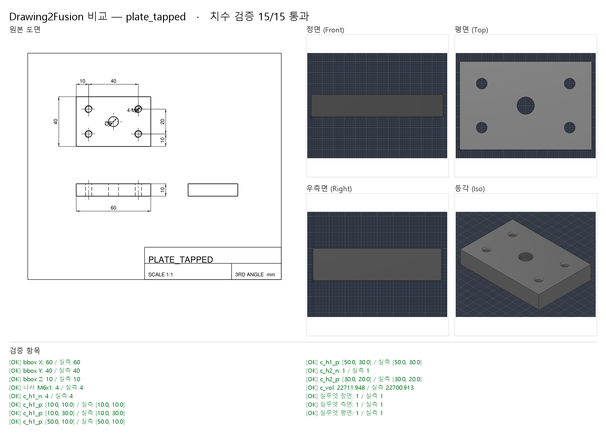

# v0.3 검증 — PDF · 옆 구멍 · 탭 · 공차 · 단면 비교 · Fusion 패널 · MCP

> 2026-10-24 · Fusion 2704.1.53 · Windows · 회귀 결과 원본 `out/regression.md` (`py -3 tools\regress.py`, 약 3분)

## 1. 요약

| 항목 | 결과 |
|---|---|
| 회귀 테스트 (실제 Fusion 빌드) | **51/51** — 스펙 8, 오류 입력 4, DXF 17(질문 답변 3 포함), **벡터 PDF 10**, 공개 도면 3, **돌연변이 9** |
| 단위 테스트 | 컨테이너(Linux) / 사용자 PC(Windows) 모두 통과, GitHub Actions(Ubuntu·Windows × Python 3.9·3.12) |
| Fusion 패널 | 패널에서 실행 → PDF 탭 플레이트 15/15, 질문 있는 도면 → 패널 질문 폼으로 답 → 다시 빌드 9/9 |
| MCP 서버 | 사용자 PC에서 `d2f_status` → `d2f_extract`(PDF 기어 블랭크) → `d2f_build` 8/8 |
| 문서 쌓임 | 회귀 51회 빌드 후에도 Fusion 열린 문서 3개 (`--close-after`) |

## 2. 새로 된 것

### 벡터 PDF ([pdf-reading.md](pdf-reading.md))
샘플 DXF 9장을 CAD 내보내기처럼 PDF로 만들어(실제 글자, 층별 굵기, 채운 화살표, 베지어 원, 낱개 해칭선, 점선 두 방식, 1:2 축척 1장)
**DXF와 같은 정답**을 요구했습니다. 10장 모두 Fusion 빌드·검증·실루엣까지 통과.

### 옆 구멍, 탭, 공차
- 정면도의 원 → Y 방향 관통 구멍, 측면도의 원 + `Ø8 DP25` → 오른쪽 면에서 25 깊이 X 방향 구멍 (위 그림, 13/13)
- `4-M6` + 탭 드릴 원 + 가는 3/4 원호 → Ø5 구멍 4개 + Fusion **M6x1 나사 피처** (아래 그림, 15/15). 큰 원을 카운터보어로 오해하지 않음
- 공차: `±0.1`, `+0.2/0`, `H6`, `h11`, `P9` → 파라미터 `tolerance`/`fit` (베벨기어: Ø35 H6 → [0, +0.016], Ø97.66 h11 → [−0.22, 0], 10 P9 → [−0.051, −0.015])

### 단면 비교 검사 (E410)
회전체는 모델을 축 평면(Y=0)으로 잘라 **도면의 해칭(재료) 영역**과 겹쳐 봅니다. 실루엣은 바깥 모양만 보기 때문에
기어 블랭크의 안쪽 웹 지름(Ø80 → Ø70)을 틀려도 실루엣 IoU는 1.000 — 단면 비교가 0.91로 잡습니다.

## 3. 회귀 결과

| 케이스 | 결과 | 종료 코드 | 검증 | 실루엣 IoU | 알림 코드 | 비고 |
|---|---|---|---|---|---|---|
| spec/bevel_gear_from_section | ✅ | 0 (기대 0) | 7/7 | - | - |  |
| spec/block_basic | ✅ | 0 (기대 0) | 4/4 | - | - |  |
| spec/block_features | ✅ | 0 (기대 0) | 9/9 | - | - |  |
| spec/bracket_l | ✅ | 0 (기대 0) | 8/8 | - | E207 |  |
| spec/clamp_bracket_from_image | ✅ | 0 (기대 0) | 13/13 | - | E207 |  |
| spec/flange | ✅ | 0 (기대 0) | 12/12 | - | - |  |
| spec/plate_holes | ✅ | 0 (기대 0) | 10/10 | - | - |  |
| spec/shaft_stepped | ✅ | 0 (기대 0) | 4/4 | - | - |  |
| broken/dim_mismatch | ✅ | 1 (기대 1) | 2/5 | - | E401 E402 E403 ERROR |  |
| broken/fillet_too_big | ✅ | 1 (기대 1) | - | - | E205 ERROR |  |
| broken/hole_outside | ✅ | 1 (기대 1) | - | - | E205 ERROR |  |
| broken/needs_answer | ✅ | 2 (기대 2) | - | - | E105 E202 E207 |  |
| dxf/block_basic | ✅ | 0 (기대 0) | 7/7 | front 1.000, side 1.000, top 1.000 | - |  |
| dxf/block_side_holes | ✅ | 0 (기대 0) | 13/13 | front 1.000, side 1.000, top 1.000 | - |  |
| dxf/bracket_l | ✅ | 0 (기대 0) | 11/11 | front 1.000, side 1.000, top 1.000 | - |  |
| dxf/broken_dim_override | ✅ | 2 (기대 2) | - | - | E107 |  |
| dxf/broken_dim_override +답변 | ✅ | 0 (기대 0) | 7/7 | front 1.000, side 1.000, top 1.000 | E107 | E107 질문에 '그려진 값' 선택 |
| dxf/broken_keyway_noview | ✅ | 2 (기대 2) | - | - | E202 E207 E208 |  |
| dxf/broken_keyway_noview +답변 | ✅ | 0 (기대 0) | 9/9 | front 0.999 | E202 E207 E208 | 키홈 폭 질문에 6 입력 |
| dxf/broken_section_dim | ✅ | 2 (기대 2) | - | - | E107 E207 E208 |  |
| dxf/broken_section_dim +답변 | ✅ | 0 (기대 0) | 8/8 | front 0.999 | E107 E207 E208 | E107 질문에 '그려진 값' 선택 |
| dxf/bushing_section | ✅ | 0 (기대 0) | 8/8 | front 0.999 | E207 E208 |  |
| dxf/flange | ✅ | 0 (기대 0) | 15/15 | front 0.998, top 0.992 | - |  |
| dxf/gear_blank_section | ✅ | 0 (기대 0) | 8/8 | front 1.000 | E207 E208 |  |
| dxf/plate_holes | ✅ | 0 (기대 0) | 12/12 | front 1.000, side 1.000, top 0.999 | - |  |
| dxf/plate_one_view | ✅ | 0 (기대 0) | 8/8 | top 1.000 | E207 |  |
| dxf/plate_tapped | ✅ | 0 (기대 0) | 15/15 | front 1.000, side 1.000, top 1.000 | - |  |
| dxf/pulley_keyway_section | ✅ | 0 (기대 0) | 9/9 | front 0.999 | E207 E208 |  |
| dxf/stepped_block | ✅ | 0 (기대 0) | 7/7 | front 0.994, side 1.000, top 1.000 | - |  |
| pdf/block_side_holes | ✅ | 0 (기대 0) | 13/13 | front 1.000, side 1.000, top 1.000 | - |  |
| pdf/bracket_l | ✅ | 0 (기대 0) | 11/11 | front 1.000, side 1.000, top 1.000 | - |  |
| pdf/bushing_section | ✅ | 0 (기대 0) | 8/8 | front 0.999 | E207 E208 |  |
| pdf/flange_1to2 | ✅ | 0 (기대 0) | 15/15 | front 0.998, top 0.992 | E207 |  |
| pdf/gear_blank_section | ✅ | 0 (기대 0) | 8/8 | front 1.000 | E207 E208 |  |
| pdf/plate_holes | ✅ | 0 (기대 0) | 12/12 | front 1.000, side 1.000, top 0.999 | - |  |
| pdf/plate_one_view | ✅ | 0 (기대 0) | 8/8 | top 1.000 | E207 |  |
| pdf/plate_tapped | ✅ | 0 (기대 0) | 15/15 | front 1.000, side 1.000, top 1.000 | - |  |
| pdf/pulley_keyway_section | ✅ | 0 (기대 0) | 9/9 | front 0.999 | E207 E208 |  |
| pdf/stepped_block | ✅ | 0 (기대 0) | 7/7 | front 0.994, side 1.000, top 1.000 | - |  |
| public/qcad_example01 | ✅ | 0 (기대 0) | 9/9 | front 0.998 | E107 E207 E208 | 베벨기어 단면도 → 자동 회전체 |
| public/qcad_flange | ✅ | 2 (기대 2) | - | - | E204 E205 E207 E208 | 평면도 + 단면도(회전체 아님) → 질문으로 멈춤 |
| public/qcad_projection | ✅ | 1 (기대 1) | 7/9 | front 0.769, side 0.985, top 0.917 | E207 E406 ERROR | 곡선 포크를 상자로 근사한 모델 → 실루엣 검사가 잡아내야 정상 (예전엔 통과로 잘못 보고) |
| mutation/block_basic: 길이 L 80→90 (치수 오독) | ✅ | 1 (기대 -) | 4/7 | front 0.891, side 1.000, top 0.891 | E405 E406 ERROR | E406 가 잡아야 함 |
| mutation/stepped_block: 윗단 길이 bx2 30→40 | ✅ | 1 (기대 -) | 5/7 | front 0.901, side 1.000, top 1.000 | E405 E406 ERROR | E406 가 잡아야 함 |
| mutation/plate_holes: 구멍 하나 위치 X 10→13 | ✅ | 1 (기대 -) | 11/12 | front 1.000, side 1.000, top 0.999 | E404 ERROR | E404 가 잡아야 함 |
| mutation/bushing_section: 몸통 길이 L4 40→45 | ✅ | 1 (기대 -) | 5/8 | front 0.917 | E405 E406 E410 ERROR | E406 가 잡아야 함 |
| mutation/gear_blank_section: 바깥 지름 D4 100→110 | ✅ | 1 (기대 -) | 5/8 | front 0.899 | E405 E406 E410 ERROR | E406 가 잡아야 함 |
| mutation/gear_blank_section: 안쪽 웹 지름 D3 80→70 (바깥 모양은 그대로) | ✅ | 1 (기대 -) | 6/8 | front 1.000 | E405 E410 ERROR | E410 가 잡아야 함 |
| mutation/plate_tapped: 탭(M6) 나사 빠뜨림 | ✅ | 1 (기대 -) | 14/15 | front 1.000, side 1.000, top 1.000 | E409 ERROR | E409 가 잡아야 함 |
| mutation/block_side_holes: 옆 구멍(Y 방향) 높이 Z 15→18 | ✅ | 1 (기대 -) | 12/13 | front 1.000, side 1.000, top 1.000 | E404 ERROR | E404 가 잡아야 함 |
| mutation/pulley_keyway_section: 키홈을 반대쪽(−Z)에 가공 | ✅ | 1 (기대 -) | 7/9 | front 0.999 | E408 E410 ERROR | E408 가 잡아야 함 |

## 4. 돌연변이 9개 — 무엇이 잡았나

| 심은 실수 | 스펙 자체 검사 | 잡은 검사 |
|---|---|---|
| 길이 L 80→90 | bbox 통과 (기대값도 따라 바뀜) | 실루엣 E406, 부피 E405 |
| 윗단 길이 30→40 | 통과 | 실루엣 E406, 부피 |
| 구멍 위치 X 10→13 | — | 구멍 위치 E404 |
| 부시 몸통 길이 40→45 | 통과 | 실루엣 E406, **단면 E410**, 부피 |
| 기어 바깥 지름 100→110 | 통과 | 실루엣 E406, **단면 E410**, 부피 |
| **기어 안쪽 웹 지름 80→70** | 통과, 실루엣 1.000 | **단면 E410**, 부피 |
| **탭 나사 빠뜨림** | 구멍 검사 통과 | **나사 E409** |
| **옆 구멍 높이 Z 15→18** | — | 구멍 위치(Y축) E404 |
| 키홈 반대쪽 | 부피·실루엣 같음 | 면 위치 E408, **단면 E410** |

## 5. 이번 작업 중 발견하고 고친 문제

| 문제 | 원인 | 조치 |
|---|---|---|
| Fusion 재시작 후 요청이 시간 초과(504) | 애드인이 **두 번 등록**돼(AppData + 바탕화면 경로) 둘 다 시작, Windows의 SO_REUSEADDR로 같은 포트를 둘 다 잡음 | 바탕화면 쪽 자동 시작 끔. 브리지를 배타적 포트(SO_EXCLUSIVEADDRUSE)로, 이미 다른 인스턴스가 있으면 이벤트를 건드리지 않고 시작 안 함 |
| 회귀 테스트 후 Fusion에 문서 수십 개 | 빌드마다 새 문서 | `--close-after` (저장 안 된 문서만 닫음, E506) |
| 나사 구멍의 위치 검사 실패 | Fusion이 나사 구멍을 규격 골지름(Ø5.035)으로 바꿈 | 나사 구멍 검사에 `diameter_tol` 0.3 |
| 같은 부품 돌연변이 2개가 서로 덮어씀 | 출력 폴더 이름이 같음 | 돌연변이마다 폴더 분리 |
| GitHub Actions Windows 실패 | Windows 체크아웃의 CRLF 줄바꿈 → 줄바꿈 테스트가 `\r\r\n`을 만듦 | 테스트 정규화 + `.gitattributes` (py/md/json은 LF, bat은 CRLF) |
| PDF 치수 글자가 이웃 치수와 뒤바뀜 | 치수마다 가장 가까운 글자를 고름 | 전체에서 가까운 순 배정 + 축척으로 값 검증 후 재배정 |
| PDF 원이 0.03% 크게 읽힘 (Ø100 → 100.014) | 베지어 원은 중간점이 부풂 | 곡선 위 끝점으로 원 맞춤 |

## 6. 남은 것

- 실제 업체·Fusion 도면 PDF로 시험 — `samples/drawings/real/`에 넣어 주시면 회귀에 추가
- 곡선 외곽 투상도(포크): 지금은 근사 모델 + 실루엣 실패 보고까지. 곡선 해석은 다음 단계
- 회전체가 아닌 단면도, 옆 구멍 카운터보어, 글자가 곡선으로 변환된 PDF
